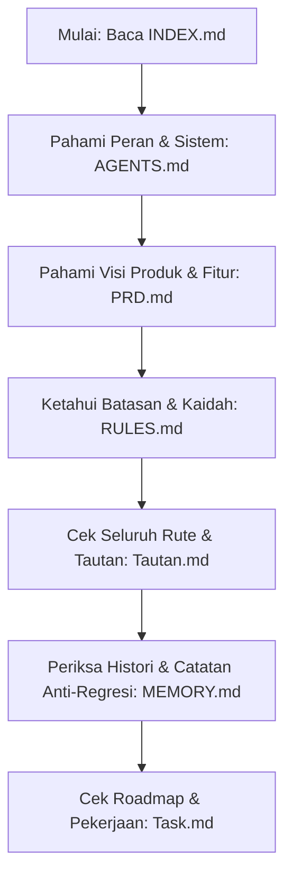

# Pintu Masuk AI (AI Entry Point) Proyek *UT Tes Formatif*

> [!IMPORTANT]
> **WAJIB BACA SEBELUM BEKERJA!**
> Ini adalah daftar isi, master indeks, dan peta pandu navigasi induk untuk seluruh agen AI.
> Selalu mulai sesi kerja Anda dari dokumen ini, lalu merujuk ke berkas relevan sesuai tugas yang diberikan.

---

## 1. Profil Lingkungan Sistem & Peladen

- **Aplikasi:** UT Tes Formatif (Evaluasi Belajar Mandiri & Kuis BMP Mahasiswa Universitas Terbuka)
- **Peladen (Server):** Armbian OS (Debian 12 bookworm on Amlogic S905x)
- **Web Server Peladen:** Apache/2.4.68 (Debian)
- **Domain Resmi Publik:** `https://ut.budi.ai.id/`
- **Port Web Utama:** `:2023` (Apache/2.4.68 (Debian) "Tes Formatif")
- **Alamat Host Peladen:**
  - Localhost Peladen: `http://localhost:2023/` atau `http://127.0.0.1:2023/`
  - Workstation LAN: `http://192.168.1.4:2023/`
  - Jaringan VPN ZeroTier: `http://10.147.17.40:2023/`
- **Jalur Akses Berkas Fisik:**
  - Sisi Server Linux: `/var/www/budi_ut/`
  - Sisi Jaringan Lokal (SMB Share Windows UNC): `\\192.168.1.4\www\budi_ut\`
  - *(Peringatan: Drive virtual `U:\` sudah dihapus dan dilarang digunakan)*
- **Manajemen Akses & Kredensial:**
  - **Operasi Berkas (CRUD):** Dilakukan langsung via SMB Share `\\192.168.1.4\www\budi_ut\` tanpa memerlukan kredensial/password SSH.
  - **Operasi Perintah Linux (Spark / Composer / Git):** Dijalankan via terminal SSH server (`root@192.168.1.4`).

---

## 2. Peta Navigasi Lengkap Direktori .agents/ (Katalog Dokumen Induk & Anak)

Sebagai dokumen induk, berikut adalah pemetaan lengkap seluruh berkas tata kelola di dalam direktori `/.agents/`:

| Berkas | Kategori | Ringkasan Isi & Fungsi Utama |
| :--- | :--- | :--- |
| **[INDEX.md](file:////192.168.1.4/www/budi_ut/.agents/INDEX.md)** | **Dokumen Induk (Master Entry Point)** | Peta navigasi menyeluruh, profil server, panduan orientasi agen, dan master indeks seluruh berkas `.agents/`. |
| **[AGENTS.md](file:////192.168.1.4/www/budi_ut/.agents/AGENTS.md)** | **Tata Kelola & Arsitektur Agen** | Taksonomi peran agen AI, arsitektur MVC CodeIgniter 4, struktur direktori fisik, katalog routing lengkap (Web & API), dan aturan eksekusi agen. |
| **[MEMORY.md](file:////192.168.1.4/www/budi_ut/.agents/MEMORY.md)** | **Memori Jangka Panjang Sistem** | Jejak histori keputusan arsitektur (ADR), re-desain database, konsolidasi routing, dan catatan anti-regresi sistemik. |
| **[PRD.md](file:////192.168.1.4/www/budi_ut/.agents/PRD.md)** | **Dokumen Kebutuhan Produk (PRD)** | Kebutuhan fungsional (FR) dan non-fungsional (NFR) platform UT Tes Formatif sesuai peran pengguna (Tamu, Mahasiswa, Admin). |
| **[RULES.md](file:////192.168.1.4/www/budi_ut/.agents/RULES.md)** | **Standar & Aturan Mutlak Pengembang** | Aturan baku pengembangan (CI4, Vue 3 CDN, Bootstrap 5.3, rute catch-all dinamis di baris paling akhir, sanitasi path-traversal). |
| **[Skills.md](file:////192.168.1.4/www/budi_ut/.agents/Skills.md)** | **Matriks Keahlian & Kompetensi** | Standar kompetensi teknis agen: Backend CI4, Routing & Filters, Frontend Vue 3 CDN, MySQL, Administrasi Apache2/Linux, dan integrasi bot. |
| **[StyleGuide.md](file:////192.168.1.4/www/budi_ut/.agents/StyleGuide.md)** | **Panduan Gaya Kode & Desain** | Standar penulisan PHP (PSR-12), konvensi URL kebab-case, penulisan reaktif JavaScript Vue 3, penamaan database SQL, dan palet warna UI. |
| **[Task.md](file:////192.168.1.4/www/budi_ut/.agents/Task.md)** | **Manajemen Tugas & Roadmap** | Status pengerjaan tugas saat ini (WIP), riwayat tugas yang telah diselesaikan (Completed), dan peta jalan fitur masa depan (Roadmap). |
| **[Tautan.md](file:////192.168.1.4/www/budi_ut/.agents/Tautan.md)** | **Direktori Tautan & Rute Lengkap** | Matriks seluruh endpoint URL web & API, host peladen, path berkas fisik kritis di server, dan tautan dokumentasi eksternal. |
| **[Telegram.md](file:////192.168.1.4/www/budi_ut/.agents/Telegram.md)** | **Otomasi & Alerting Bot** | Konfigurasi Bot Telegram, kredensial, rute pemanggil notifikasi non-blocking (timeout 2s), dan template pesan HTML. |

---

## 3. Panduan Navigasi Aksi bagi Agen AI (Sesuai Peran & Tugas)

Ikuti panduan navigasi berikut untuk menentukan berkas rujukan spesifik sesuai dengan tugas yang Anda emban:

1. **Aturan Mutlak:** Baca [RULES.md](file:////192.168.1.4/www/budi_ut/.agents/RULES.md) untuk mengetahui pantangan, batasan arsitektur, dan keamanan.
2. **Konteks & Visi:** Jika Anda ditugaskan mengembangkan arsitektur/kerangka kerja atau fitur baru, baca [PRD.md](file:////192.168.1.4/www/budi_ut/.agents/PRD.md) dan [Tautan.md](file:////192.168.1.4/www/budi_ut/.agents/Tautan.md).
3. **Standar Penulisan & Teknis:** Jika Anda ditugaskan menulis kode baru atau refaktorisasi, wajib mematuhi standar di [StyleGuide.md](file:////192.168.1.4/www/budi_ut/.agents/StyleGuide.md).
4. **Layanan Eksternal & Integrasi (Microservices):** Untuk tugas spesifik yang berinteraksi dengan API pihak ketiga atau mesin bot, pelajari dokumen mandiri berikut (berdasarkan peran di [AGENTS.md](file:////192.168.1.4/www/budi_ut/.agents/AGENTS.md) dan pedoman umum di [Skills.md](file:////192.168.1.4/www/budi_ut/.agents/Skills.md)):
   - 💬 **Sistem Chatbot & Notifikasi:** Baca [Telegram.md](file:////192.168.1.4/www/budi_ut/.agents/Telegram.md).
5. **Tugas Saat Ini:** Lihat [Task.md](file:////192.168.1.4/www/budi_ut/.agents/Task.md) untuk mengecek fitur apa yang harus Anda kerjakan hari ini.
6. **Log Kesalahan & Keputusan Lalu:** Baca [MEMORY.md](file:////192.168.1.4/www/budi_ut/.agents/MEMORY.md) agar Anda tidak mengulangi kesalahan fatal (*bug*) dan memahami keputusan rekayasa masa lalu.

---

## 4. Alur Orientasi bagi Agen Baru (*Onboarding Guide*)

Bagi agen AI yang pertama kali beroperasi pada repositori ini, ikuti urutan pembacaan berkas secara berjenjang berikut:

---

## 5. Direktori Kritis Proyek

Untuk navigasi cepat ke area kerja utama di repositori:

- **Pusat Panduan & SOP Agen:** [.agents/](file:////192.168.1.4/www/budi_ut/.agents/)
- **Aplikasi Inti (CodeIgniter 4):**
  - Controllers: [app/Controllers/](file:////192.168.1.4/www/budi_ut/app/Controllers/) & [app/Controllers/Api/](file:////192.168.1.4/www/budi_ut/app/Controllers/Api/)
  - Models: [app/Models/](file:////192.168.1.4/www/budi_ut/app/Models/)
  - Views & Layout: [app/Views/](file:////192.168.1.4/www/budi_ut/app/Views/)
- **Frontend Assets & Vue.js 3:** [public/js/](file:////192.168.1.4/www/budi_ut/public/js/) & [public/css/](file:////192.168.1.4/www/budi_ut/public/css/)
- **Penyimpanan Berkas Terproteksi:** [writable/MK/](file:////192.168.1.4/www/budi_ut/writable/MK/) & [writable/PROFIL/](file:////192.168.1.4/www/budi_ut/writable/PROFIL/)

*(Rincian pohon direktori fisik lengkap beserta seluruh berkas MVC dapat dilihat pada [Bab 3 AGENTS.md](file:////192.168.1.4/www/budi_ut/.agents/AGENTS.md#3-struktur-direktori-fisik-proyek-terkini))*.
